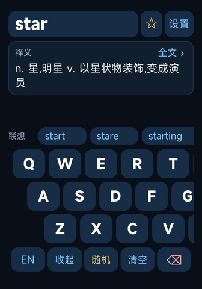
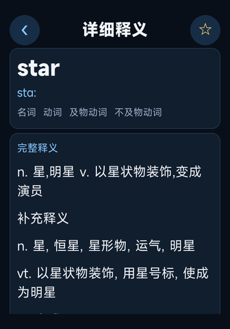
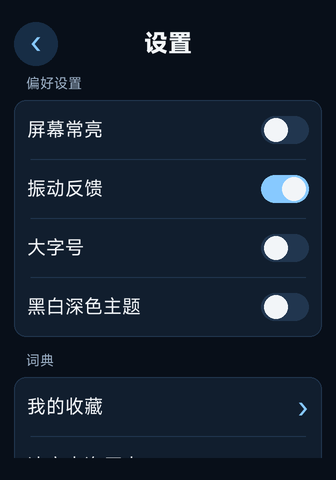

# 星词典 Star Dictionary

面向小米手环 9 Pro / 10 Pro 的 Vela JS 离线英汉词典。

本仓库用于展示已完成的应用版本，供轻腕社区开发者申请审核及用户了解作品。当前提供版本为 **1.2.2**。

## 功能

- 约 10 万英文词条，支持离线查询。
- 英文查询与中文全拼查词。
- 中文释义、音标、词性等词条资料；点击释义卡可查看详情。
- 单词收藏与最近查询。
- 500 条中英金句。
- 大字号、深蓝主题与黑白深色主题。

## 界面预览

以下图片根据 1.2.2 编译模板与实际词库近似渲染，用于说明界面，**并非手环或官方原生模拟器截图，实机显示为准**。不同词条提供的释义资料可能不同。

| 查词与输入 | 详细释义 | 阅读偏好 |
| --- | --- | --- |
|  |  |  |

## 安装包与使用

[下载星词典 1.2.2 RPK](app/star-dictionary-1.2.2.rpk?raw=true)

1. 使用设备支持的 Vela 快应用安装方式导入 RPK。
2. 首次打开后，将激活页显示的设备码发给开发者。
3. 收到激活码后输入，即可在对应设备使用。
4. 查询时输入英文，或切换中文输入拼音并选字；点击释义卡查看详情。

适用机型按作者提供的兼容信息列为小米手环 9 Pro / 10 Pro；此作品集不表示两个机型均已完成真机验证。

## 价格与联系

前 100 名购买者人民币 1 元，第 101 名起 1.5 元。一次买断，绑定单设备永久使用，查询不限次数，无需订阅。激活码与设备绑定，不跨设备通用。

交流 QQ 群：**1077023371**。

## 版本信息

- 版本：1.2.2 / versionCode 52。
- 包名：com.stardict.band10pro。
- RPK SHA-256：02a62a65539f763dd34f1cc2e6733186841ab2087616407d2834aeee8cded849。

本仓库提供作品介绍、预览图片与安装包，不包含应用源码。数据与工具来源见 [第三方声明](THIRD_PARTY_NOTICES.md)。
